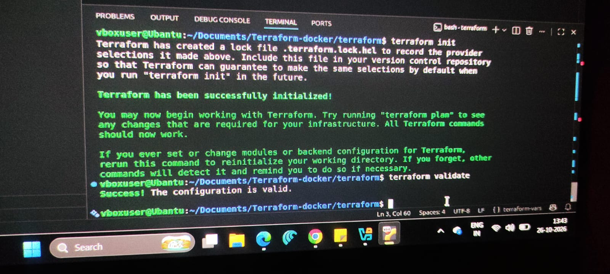
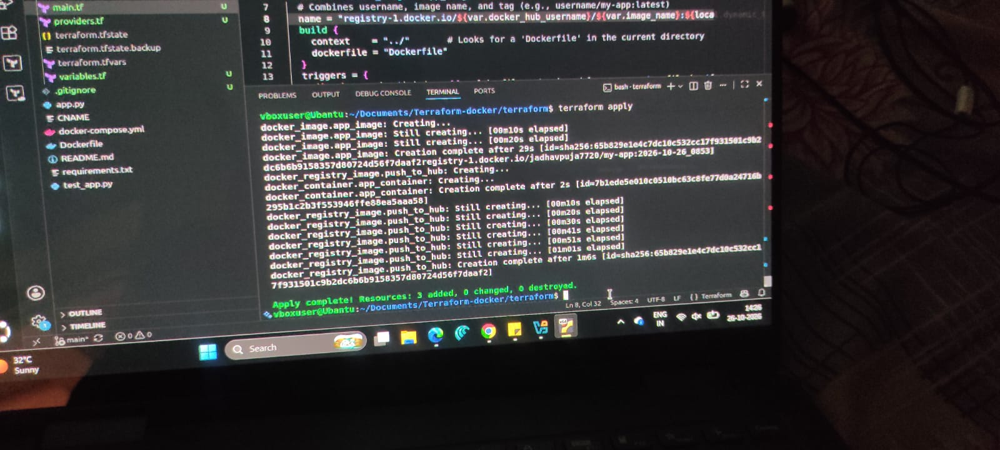
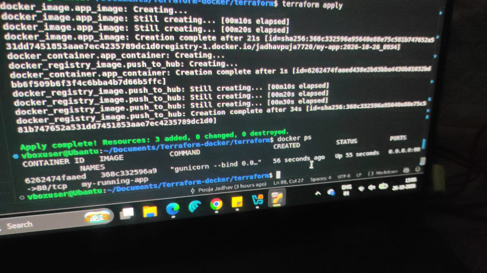
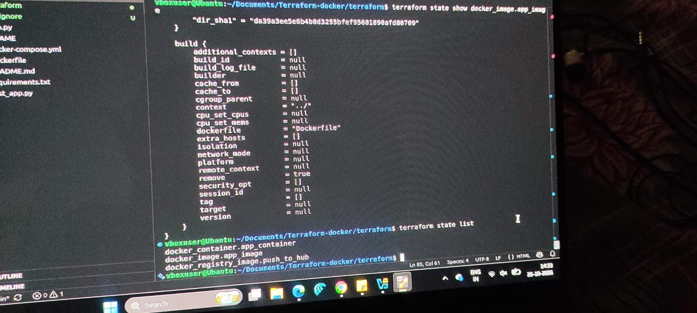

# Terraform with Docker

A **Flask web app** deployment using **Terraform and docker provider**.
Terraform configuration buils the image push it to docker hub and deploy pushed image to a local docker container

## What's Inside

This repo contains a **Flask web app** with a full **Terraform config** to build docker image, push to dockerhub and deploy locally

```
app.py                  → Flask app (source code)
Dockerfile              → Container image definition
docker-compose.yml      → Production deployment config
templates/index.html    → App frontend
requirements.txt        → Python dependencies (flask, flake8, bandit, gunicorn, pytest)
test_app.py             → Route tests (pytest)
Terraform/              →  config for deployment on docker
```

###  Terraform Files


```
push to main
    ├── main.tf ──── resource blocks
    ├── variables.tf ─ variables
    └── providers.tf──── provider blocks
```
### IaC & Terraform
- What is **Infrastructure as Code**, and what problems does it solve compared to clicking around a cloud console?
  Creating a cloud infrastructure via cloud console might work for personal project but its difficult when the project is    big and need to provosion various resourses via console. So IaC tool like Terraform is a must thing while working with     projects. Using Terraform its easier to provision resources and the code can be made resuable by creating modules. 
- What is **Terraform**, and why is it so popular? (Hint: declarative, provider-agnostic, huge ecosystem.)
  Terraform is a **Infrastructure as Code** tool. Its popular because with the help of this tool we can provision            resources in any cloud or on premises. Its declarative approach makes it easy to use.

### Install Terraform (latest version)
- Install **Terraform ≥ 1.15** using the [official install guide](https://developer.hashicorp.com/terraform/install).
- Verify your install and **paste the output** in your notes:

```bash
terraform version
terraform -help
```

### 6 Crucial Terraform Terminologies
Explain each of these **in your own words** with a one-line example:
1. **Provider** — a plugin that lets Terraform talk to a platform (AWS, Azure, Docker…).
   -Its a plugin which helps terraform to interact with platforms.
   
2. **Resource** — a piece of infrastructure you want to create (an EC2 instance, an S3 bucket…).
   Resource defines the kind of infrastructure object.
   
3. **State** — Terraform's record of what it manages (the `terraform.tfstate` file).
   This file stores information about your managed infrastructure and configuration. 
4. **Plan** — a preview of the changes Terraform will make.
   It allows to see the changes Terraform will make to your infrastructure before applying them.
   ```bash
   terraform plan
   ```
5. **HCL** — HashiCorp Configuration Language, the syntax you write Terraform in.
   Its a language used to write terraform configuration.
6. **Module** — a reusable, packaged group of Terraform configuration.
   Its a collection of standard configuration files.


Run the **core Terraform workflow** and capture the output of each step:
```bash
cd example
terraform init      # download providers, initialize the working directory
terraform fmt       # format your code
terraform validate  # check for syntax errors
terraform plan      # preview what will be created
terraform apply     # create the resources (type: yes)
terraform destroy   # clean up (type: yes)
```
## 🔁 The Core Terraform Workflow

```
  Write  ──▶  Init  ──▶  Plan  ──▶  Apply  ──▶  Destroy
  (.tf)     (init)     (preview)   (create)    (clean up)
```

---
## Understanding
During initialization terraform generated .terraform.lock.hcl which contains provider version, provider checksum, Dependency information. This ensures that everyone in team should use same provider version.

The successful deployment is as below





